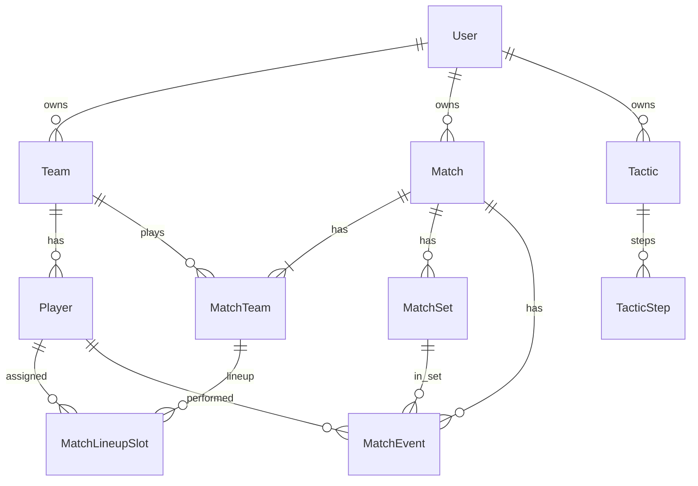

# Adatbázis (PostgreSQL + Prisma)

Séma: [`backend/prisma/schema.prisma`](../backend/prisma/schema.prisma).  
Domén indoklás: [`project-context.md`](../project-context.md) §4–8.

## Helyi környezet

```bash
docker compose up -d   # Postgres :5432, pgAdmin :5050
cd backend
copy .env.example .env
npm install
npx prisma migrate deploy
npx prisma db seed      # opcionális demo adat
```

| Szolgáltatás | Érték |
|--------------|--------|
| Host | `localhost:5432` |
| DB / user / jelszó | `volleylab` |
| Dev séma | `public` (`DATABASE_URL` → `?schema=public`) |

**pgAdmin:** http://localhost:5050 — `admin@volleylab.dev` / `admin`.  
Új szerver: host `db` (compose hálózaton) vagy `localhost`, port 5432.

## Séma gyors áttekintés



**Nincs DB-ben:** formation sablon (5-1 / 6-2 / 4-2 slot listák) — kódban: `backend/src/formations/`.

### Fő modellek

| Modell | Szerep |
|--------|--------|
| `User` | Auth tulajdonos |
| `Team` / `Player` | Csapat; mezszám egyedi csapaton belül; `isActive` soft delete |
| `Match` | Tulajdonos user; státusz `PLANNED` → `IN_PROGRESS` → `FINISHED` |
| `MatchTeam` | Pontosan 2 oldal (`HOME` / `AWAY`), formation enum, egy csapat nem játszik önmagával |
| `MatchLineupSlot` | **Aktuális** felállás (slot → player); változáskor az események továbbra is `playerId`-re mutatnak |
| `MatchSet` | **Kézi** pontok (`homeScore` / `awayScore`), függetlenül az eseményektől |
| `MatchEvent` | Statisztika forrása: `action` + `result` (érvényesség a service-ben) |
| `Tactic` / `TacticStep` | Userhez tartozik; lépések **slot**-ra, nem player id-re; `basePositions` JSON |

### Fontos enumok

- **Slot** — pályapozíció a felállásban (`MIDDLE_1` ≠ `MIDDLE_2`).
- **PlayerRole** — állandó játékos szerepkör a csapatnál.
- **EventAction / EventResult** — melyik pár engedett: `event-rules.ts`.
- **TacticAction** — `MOVE`, `RECEIVE`, `SET`, `ATTACK`, `BLOCK`.

## Migrációk

```bash
cd backend
npx prisma migrate dev    # schema.prisma módosítás után (dev)
npx prisma migrate deploy # CI / Railway / csak alkalmazás
```

Jelenlegi migrációk (`prisma/migrations/`):

1. `20261007110626_init` — alap táblák
2. `20261008213515_tactic_base_positions_and_delay`
3. `20261008235900_tactic_rotation_libero`
4. `20261009120000_tactic_step_parallel`

## Seed

```bash
npx prisma db seed
```

[`backend/prisma/seed.ts`](../backend/prisma/seed.ts): két user, három csapat, három mérkőzés (planned / live / finished), több példa taktika (5-1, 6-2, 4-2).

## Tesztek és sémák

| Parancs | Adatbázis |
|---------|-----------|
| `npm test` | Nem használ Postgres-t |
| `npm run test:e2e` | Ugyanaz a DB, **`test` séma** (`backend/.env.test`) |

Az e2e futás előtt `global-setup` lefuttatja a `migrate deploy`-t a `test` sémára; a tesztek között a táblák ürülnek — a **`public` séma (dev adat) érintetlen**.

A runner elutasítja a futást, ha a `DATABASE_URL` nem tartalmazza: `schema=test`.

## Törlési szabályok (Prisma)

| Forrás | Viselkedés |
|--------|------------|
| User törlése | cascade: teams, matches, tactics |
| Match törlése | cascade: match teams, sets, events, lineup |
| Team törlése meccsben | **Restrict** (nem törölhető) |
| Player eseménnyel / lineupban | **Restrict**; alkalmazásban soft delete (`isActive = false`) |

## Production (Railway)

- Postgres szolgáltatás `DATABASE_URL` (gyakran `?sslmode=require`).
- Backend entrypoint: migráció + indítás — lásd `backend/docker-entrypoint.sh`.
- Schema változásnál új deploy; **ne** futtass élesben `migrate reset`-et.

## Hasznos parancsok

```bash
npx prisma studio          # böngészős szerkesztő (dev)
npx prisma validate        # séma ellenőrzés
npx prisma generate        # client (npm install is futtatja)
```